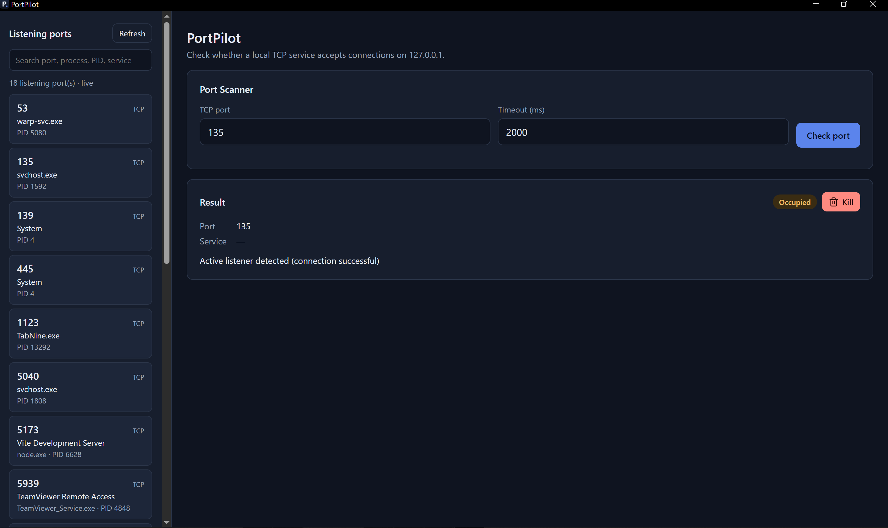

# PortPilot 🚀

[](https://github.com/senpai295/portpilot/actions/workflows/ci.yml)
[](https://go.dev/)
[](LICENSE)

**PortPilot** is a lightweight, cross-platform tool written in Go that helps developers identify occupied TCP ports, inspect listening processes, list active listening ports, troubleshoot port conflicts, and export audit reports. It ships as a **command-line tool** and as a **desktop app** built with [Wails v2](https://wails.io).

Designed with **zero third-party dependencies** in the CLI, PortPilot combines concurrent port scanning, cross-platform process inspection, customizable service mappings, and automated testing in a simple developer-friendly interface.

## ✨ Features

- **Port Inspection:** Check whether a TCP port is available or occupied using TCP connection checks and a local bind fallback.
- **Process Identification:** Identify applications and process IDs (PIDs) associated with listening ports on Linux, macOS, and Windows.
- **System-Wide Port Listing:** Discover active listening TCP ports using `portpilot list`, with optional JSON output.
- **Concurrent Range Scanning:** Scan custom port ranges using bounded worker pools to control resource usage.
- **Service Recognition:** Recognize common development services, databases, and infrastructure tools, including PostgreSQL, MySQL, MongoDB, Redis, Oracle, Microsoft SQL Server, Elasticsearch, and Kafka.
- **Team-Shared Configuration:** Define custom service-to-port mappings in a `.portpilot.json` configuration file.
- **Multiple Output Formats:** Display results in the terminal, produce JSON output, or export Markdown and JSON reports.
- **Desktop App:** A graphical interface with a port scanner, a live listening-port sidebar, search, and a confirmed kill action. See the Desktop App section below.
- **Zero External Dependencies (CLI):** The CLI is built entirely with Go's standard library, including `net`, `os/exec`, `context`, and `sync`.

## 🖥️ Platform Support

| Operating System | Inspection Utilities   | CLI       | Desktop App     |
| ---------------- | ---------------------- | --------- | --------------- |
| Linux            | `ss` / `lsof`          | Supported | Supported       |
| macOS            | `lsof`                 | Supported | Not yet tested  |
| Windows 11       | `netstat` / `tasklist` | Supported | Supported       |

> **Note:** Process inspection depends on the availability of system utilities and the current user's permissions. PortPilot cannot always identify a process when access is restricted or the required utilities are unavailable.

## 📦 Installation

### Prerequisites

- Go 1.25 or later
- Git

### Install with Go

Install the CLI directly from the module proxy:

```bash
go install github.com/senpai295/portpilot/cmd/portpilot@latest
portpilot --help
```

> **Note:** `go install` requires Go 1.25 or later. `@latest` installs the newest tagged release.

### Build from Source

Clone the repository and build the executable:

```bash
git clone https://github.com/senpai295/portpilot.git
cd portpilot

go build -o bin/portpilot ./cmd/portpilot
```

Run the compiled binary:

```bash
./bin/portpilot --help
```

To make `portpilot` available globally, move the binary into a directory on your `PATH`.

## 🛠️ Usage

### 1. Check a Single Port

Check whether port `3000` is available or occupied:

```bash
portpilot check 3000 --timeout 2s
```

### 2. Inspect a Listening Process

Inspect the process associated with port `8080`:

```bash
portpilot inspect 8080
```

### 3. List Active Listening Ports

Display active listening TCP ports:

```bash
portpilot list
```

Output results in JSON format:

```bash
portpilot list --format json
```

### 4. Scan a Port Range

Scan ports `3000` through `3100`:

```bash
portpilot scan --start 3000 --end 3100
```

### 5. Use JSON Output

Generate machine-readable results for scripts and automation:

```bash
portpilot scan --start 3000 --end 3050 --format json
```

### 6. Export Reports

Export scan results to Markdown or JSON:

```bash
portpilot scan --start 8000 --end 8100 --output report.md
portpilot scan --start 5400 --end 6400 --output database_ports.json
```

> These examples assume the CLI flags and output formats are supported by your current implementation.

## 🖥️ Desktop App

PortPilot's desktop app provides the same port checking and process logic as the CLI, in a graphical window. It's built with [Wails v2](https://wails.io), using a Go backend and a TypeScript frontend.



### Features

- **Port Scanner:** Check any TCP port from 1 to 65535, with a configurable timeout. Results show Available, Occupied, or Error.
- **Live Listening-Port Sidebar:** Lists active TCP listeners and refreshes automatically when the set changes.
- **Search:** Filter the sidebar by port number, protocol, service name, PID, or process name. Press Escape to clear the search.
- **Service Labels:** Shows a known service name for well-known ports, plus custom labels from `.portpilot.json`. Service names are guesses based on the port number, so compare them with the process name.
- **Kill with Confirmation:** Terminate the process on an occupied port. The app shows the process name and PID first, and terminates only that PID if it still owns the port.

### Running the Desktop App

Requirements:

- [Go](https://go.dev/dl/) 1.25 or later
- [Node.js](https://nodejs.org/) 18 or later
- The [Wails CLI](https://wails.io/docs/gettingstarted/installation)
- **Linux only:** GTK 3 and WebKit2GTK development packages. Run `wails doctor` to see which packages are missing for your distribution.

```bash
cd cmd/portpilot-desktop

# Install frontend dependencies and build the UI
cd frontend && npm install && npm run build && cd ..

# Development mode with hot reload
wails dev

# Production build
wails build
```

The desktop app is built from the same repository as the CLI, but `go install` installs only the CLI. Building the desktop app requires the Wails CLI and the frontend steps above.

### Custom Service Labels

The desktop app reads `.portpilot.json` from the directory you run it from. Use the same format as the CLI:

```json
{
  "ports": [
    { "port": 4000, "service": "Custom Team API Gateway" }
  ]
}
```

Custom labels load when the app starts, so restart the app after editing the file.

### Platform Notes

- The desktop app has been tested on **Windows 11** and **Linux**. It has **not** been tested on macOS.
- On Windows, process names are resolved with `tasklist`. On Linux, process inspection uses `ss` or `lsof`. Processes owned by other users or by the system may appear as unverified on either platform.
- Port matching is exact. A search for port `3000` does not match `30000`.
- Terminating a process may require administrator rights (Windows) or root privileges (Linux), depending on who owns it.

## ⚙️ Team Configuration

PortPilot supports custom service mappings through a `.portpilot.json` file. Place the file in your project root or specify its location using the `--config` option.

Example configuration:

```json
{
  "ports": [
    {
      "port": 4000,
      "service": "Custom Team API Gateway"
    },
    {
      "port": 5433,
      "service": "Staging PostgreSQL Instance"
    }
  ]
}
```

Use a custom configuration file when scanning a port range:

```bash
portpilot scan --start 3000 --end 6000 --config .portpilot.json
```

This allows team members to share project-specific service mappings through version control.

### 🔪 Terminate a Process by Port

PortPilot can terminate a process listening on a specified port, with an interactive confirmation prompt by default to help prevent accidental termination.

#### 1. Interactive Termination

Terminate the process associated with port `8080`:

```bash
portpilot kill 8080
```

PortPilot displays the identified process and asks for confirmation before proceeding:

```text
Target Process Found:
  Port:     8080
  PID:      65174
  Process:  http-server
  Details:  Process identified via ss (PID: 65174)

Are you sure you want to terminate process 'http-server' (PID: 65174)? [y/N]: y

Terminating process (PID: 65174)...
Successfully terminated process 65174 on port 8080.
```

- **Confirm with `y`:** Proceed with termination.
- **Press Enter or enter `n`:** Cancel the operation.
- **Process identification:** Display the target process details before requesting confirmation.

#### 2. Non-Interactive Termination

For automation scripts, CI pipelines, and other non-interactive environments, use `--force` to skip the confirmation prompt:

```bash
portpilot kill 8080 --force
```

Use this option carefully, as the process may be terminated without an interactive opportunity to review the target.

#### 3. Example: Free a Development Port

```bash
#!/usr/bin/env bash
set -euo pipefail

PORT=8080

echo "Attempting to free port $PORT..."
portpilot kill "$PORT"

echo "Port cleanup command completed."
```

**Security note:** Terminating processes may interrupt running applications or cause data loss. PortPilot should verify the target process, handle permission errors, and clearly report whether termination succeeded or failed. The `--force` flag should bypass confirmation only, not process validation or safety checks.

### 🚀 Scripting & Automation

PortPilot's JSON output makes it easy to integrate port inspection and scanning into shell scripts, CI pipelines, and developer workflows. Combine it with tools like [`jq`](https://jqlang.github.io/jq/) to filter results and automate routine tasks.

> **Prerequisites:** Install `jq` and ensure `portpilot` is available on your `PATH`. The examples below use lowercase JSON field names such as `pid` and `service`. Check your output with `portpilot inspect 8080 --format json` if a filter returns nothing.

#### 1. Check Port Availability in Bash

Check whether PostgreSQL's default port (`5432`) is occupied:

```bash
if [ "$(portpilot check 5432 --format json | jq -r '.status')" = "OCCUPIED" ]; then
    echo "PostgreSQL port is busy!"
else
    echo "PostgreSQL port is available."
fi
```

#### 2. Inspect a Process on a Port

Extract the PID of the process associated with port `8080`:

```bash
portpilot inspect 8080 --format json |
    jq -r '.process.pid // empty'
```

You can use the PID in other automation workflows. Always verify the target process before terminating it.

#### 3. Find Node.js Services

List listening ports associated with services identified as Node.js:

```bash
portpilot list --format json |
    jq '.ports[] | select(.service | strings | contains("Node"))'
```

This filters the JSON output to entries whose `service` field contains `Node`.

#### 4. Export an Audit Report

Save a machine-readable snapshot of a port range for later analysis:

```bash
portpilot scan \
    --start 8000 \
    --end 8100 \
    --format json \
    --output port-audit.json
```

Inspect the exported report:

```bash
jq '.' port-audit.json
```

#### 5. Integrate Port Checks into CI

Fail a script when a required development port is already occupied:

```bash
#!/usr/bin/env bash
set -euo pipefail

PORT=3000
STATUS=$(portpilot check "$PORT" --format json | jq -er '.status')

if [[ "$STATUS" == "OCCUPIED" ]]; then
    echo "Error: port $PORT is already occupied." >&2
    exit 1
fi

echo "Port $PORT is available."
```

### 🛠️ Troubleshooting & Advanced Guide

Having issues with port inspection, permissions, timeouts, or configuration? See the **[PortPilot Troubleshooting & Advanced Guide](TROUBLESHOOTING.md)** for solutions, platform-specific guidance, and scripting examples.

## 🧪 Testing

PortPilot includes unit tests for its core components. Tests can use ephemeral local listeners to reduce dependence on external networks and avoid conflicts with commonly used ports.

Run the complete test suite:

```bash
go test -v ./internal/... ./cmd/portpilot/...
```

Run the tests with the Go race detector:

```bash
go test -race ./internal/... ./cmd/portpilot/...
```

Run static analysis:

```bash
go vet ./internal/... ./cmd/portpilot/...
```

> The desktop app (`cmd/portpilot-desktop`) is excluded from these commands because it embeds the built frontend. Build the frontend first (see [Running the Desktop App](#running-the-desktop-app)) before running `go test ./...`.

## 🏗️ Project Structure

```text
portpilot/
├── cmd/
│   ├── portpilot/
│   │   └── main.go
│   └── portpilot-desktop/
│       ├── main.go
│       ├── wails.json
│       └── frontend/
│           ├── index.html
│           ├── package.json
│           ├── tsconfig.json
│           ├── vite.config.ts
│           └── src/
│               ├── main.ts
│               └── style.css
├── docs/
│   └── screenshots/
│       └── desktop-scanner.png
├── internal/
│   ├── config/
│   │   ├── config.go
│   │   └── config_test.go
│   ├── desktop/
│   │   └── app.go
│   ├── ports/
│   │   ├── checker.go
│   │   ├── checker_test.go
│   │   ├── scanner.go
│   │   └── scanner_test.go
│   ├── process/
│   │   ├── inspector.go
│   │   ├── inspector_linux.go
│   │   ├── inspector_darwin.go
│   │   └── inspector_windows.go
│   └── report/
│       ├── report.go
│       └── report_test.go
├── go.mod
├── LICENSE
└── README.md
```

- `cmd/portpilot/` — CLI entry point and command orchestration.
- `cmd/portpilot-desktop/` — Wails desktop app entry point, configuration, and frontend.
- `internal/config/` — Configuration loading and validation.
- `internal/desktop/` — Go methods bound to the desktop frontend.
- `internal/ports/` — Port checking, scanning, and service mappings.
- `internal/process/` — Platform-specific process inspection.
- `internal/report/` — JSON and Markdown report generation.

## 🗺️ Project Roadmap

- [x] **Core Network Diagnostics:** Dual-strategy TCP port checking & concurrent range scanning.
- [x] **Cross-Platform Process Inspection:** Native integration with Linux (`ss`/`lsof`), macOS (`lsof`), and Windows (`netstat`/`tasklist`).
- [x] **Team-Shared Configuration:** Support for custom `.portpilot.json` service mapping files.
- [x] **Automation & Scripting:** Uniform JSON output formatting across all commands for `jq` and CI/CD pipelines.
- [x] **Active Port Listing & Real-Time Watching:** System-wide listing (`portpilot list`) and live monitoring (`portpilot watch`).
- [x] **IoT & Consumer Device Port Recognition:** Curated database mappings for smart home hubs, Wi-Fi cameras, and streaming devices.
- [x] **Desktop App (Windows and Linux):** Wails-based GUI with port scanning, a live listening-port sidebar, search, and confirmed process termination.
- [ ] **Desktop App (macOS):** Test and verify builds on macOS.
- [ ] **Embedded Web Dashboard:** Lightweight local web UI (`portpilot web`) for visual port monitoring.
- [ ] **Remote Host Scanning:** Scan remote server IP addresses with secure tunneling integration.
- [ ] **Configurable Alerting Webhooks:** Trigger Discord/Slack notifications when critical database or IoT ports drop or experience conflicts.

Have an idea or feature request? Open an issue or submit a pull request.

## 🤝 Contributing

Contributions, bug reports, and feature requests are welcome.

1. Fork the repository.
2. Create a feature branch.
3. Make your changes and add tests.
4. Run `go test ./internal/... ./cmd/portpilot/...` and `go vet ./internal/... ./cmd/portpilot/...`.
5. Open a pull request describing your changes.

Please keep changes focused, well-tested, and consistent with idiomatic Go practices.

## 📄 License

PortPilot is distributed under the [MIT License](LICENSE).
